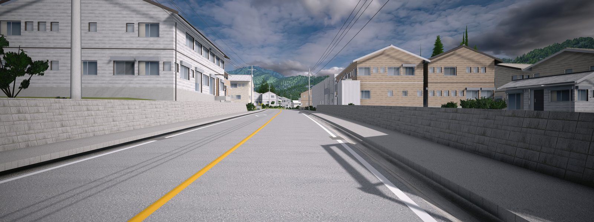
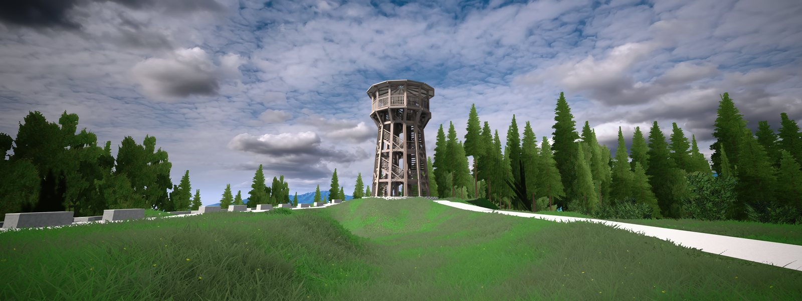
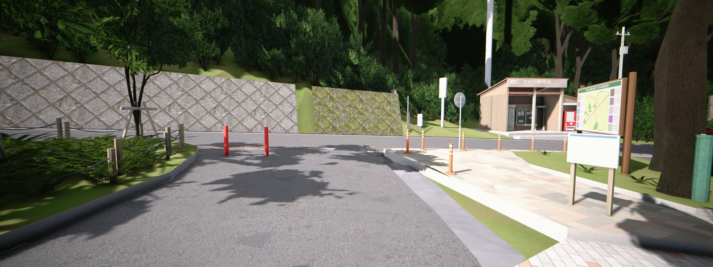
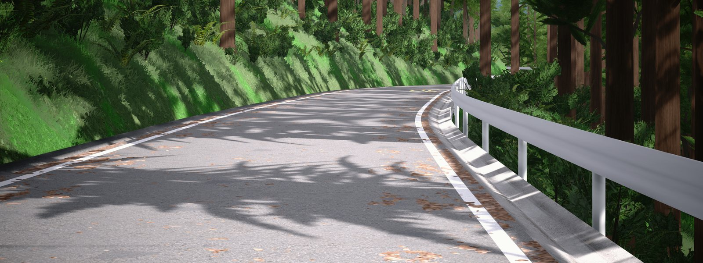
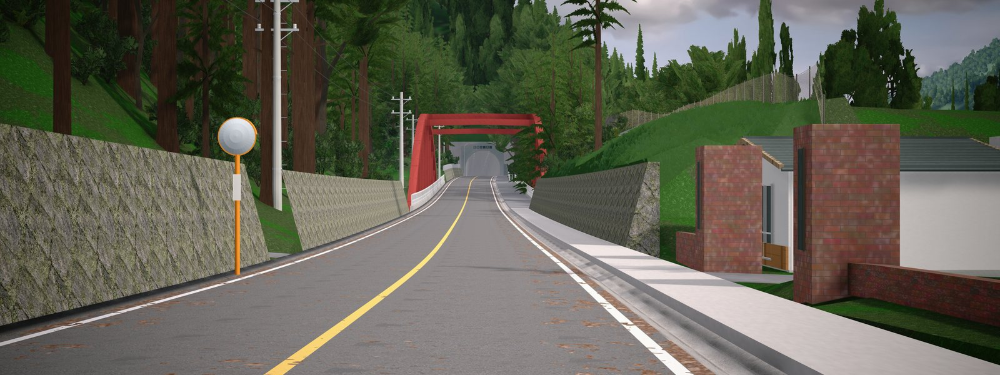
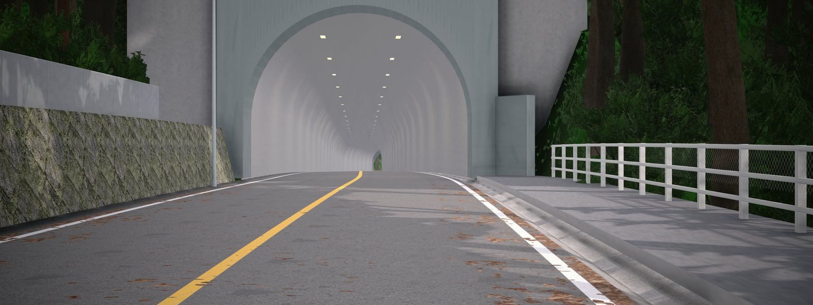
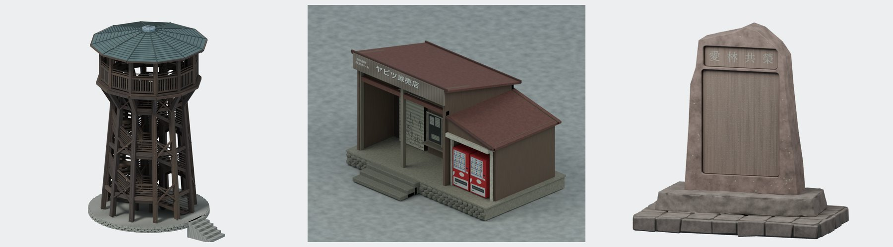
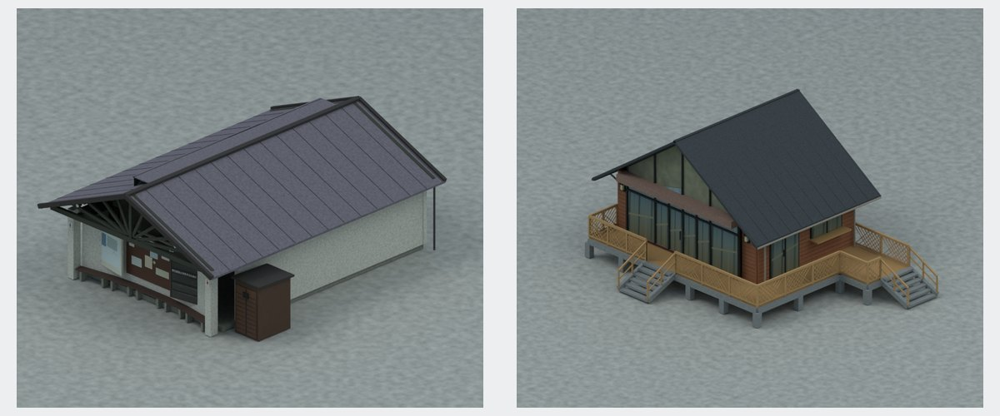

# ヤビツ峠（Assetto Corsa コース）

神奈川県の県道70号（秦野清川線）、名古木からヤビツ峠を越えて宮ヶ瀬北原までの約 29.9km を、地図・標高データ・ストリートビューをもとに Assetto Corsa のコースとして作るプロジェクトです。

> **このコースとデータは、自由に使ってください。** 走る・改造する・別のコースや MOD に組み込む・再配布する・研究や学習に使う、どれも連絡や許可は要りません。
> ただし、**作者は著作権とライセンスを放棄していません**（パブリックドメインや CC0 ではありません）。使うときは、作者名とこのリポジトリの表示・販売しないこと・出典を残すことだけ守ってください。くわしくは [ライセンス](#ライセンス) へ。

最新版：**v0.0.4**（2026-11-21）

## 見どころ

道ぎわの物は、ストリートビューと地図を見ながら 1 つずつ作っています。


**名古木の町並み**：家・アパート・物置を、窓・ベランダ・軒・雨樋などの部品で建てています。電柱と電線、石積みの擁壁も実際の大きさです。


**菜の花台**：十二角形の木の展望台（高さ約 13 m、二重らせんの階段）と、駐車場の縁のベンチ。


**ヤビツ峠**：売店の店構えと看板・自販機、駐車場の車止め、植え込み、案内板、擁壁の模様まで現地に合わせました。


**山道**：道ぎわの斜面を草と下草で覆い、スギ・ヒノキ・広葉樹の林を空中写真から植えています。路面の落ち葉、ガードレールも入っています。


**吹風トンネルの手前**：赤いアーチ橋、れんがの門、間知石の擁壁、反射鏡。


**吹風トンネル入口**：坑口の形、トンネルの中の照明、歩道の柵。

### 作り込んだ 3D モデル


左から：菜の花台の展望台、ヤビツ峠の売店（自販機・看板つき）、浅間神社の駐車場の石碑「愛林共栄」


左から：ヤビツ峠のトイレ、レストハウス

このほか、カーブミラー・電柱・km の標・標識・ガードレール・擁壁・側溝・ゲート・橋の欄干・トンネルの坑口など、県道70号沿いの物を型ごとに作って並べています。

<sub>画面は Assetto Corsa＋Custom Shaders Patch のゲーム画面（5120×1440 の真ん中を切り出し）。どれも v0.0.4 の画面です。3D モデルの絵は Blender で描いたものです。</sub>

## ダウンロード（Assetto Corsa の MOD）

**[最新版のダウンロード（Releases）](https://github.com/poropi/yabitsu-touge-ac/releases/latest)** から `yabitsu-touge-ac-v<版>.zip` を落とし、Content Manager の画面に zip を落とすか、zip の中の `content` フォルダを Assetto Corsa のフォルダに上書きでコピーします。前の版から更新するときは、`content/tracks/yabitsu` を消してから入れると古いファイルが残りません。

### 推奨環境

| | |
|---|---|
| 必要 | Custom Shaders Patch（CSP）。森・路面や擁壁の模様・夜の明かり・雨・環境音は CSP で表示します |
| 確かめた CSP | 0.3.0-preview619（これより古い版では確かめていません） |
| 天気 | Pure 2.57 で確かめました（なくても走れます） |
| 確かめた PC | Core i7-14700K / GeForce RTX 5070 / メモリ 64GB / Windows 11 |
| 重さ（DLSS なし） | 5120×1440 全画面、全線の決まった 17 か所で止めて測って、平均 約 67 FPS・最低 約 50 FPS |
| 重さ（DLSS あり） | DLSS Balanced（0.58）で最初の 6km を走って、平均 約 76 FPS・最低 約 61 FPS |
| ディスク | 展開後 約 4.4GB（zip は約 1.5GB） |

v0.0.4 では、山の高い木を軽い作りに置き換えて、DLSS が使えない PC でも 60 FPS 前後を保てるようにしました。全線を走り通しての測定はまだしていません。

### 確かめたときの AC の設定

- 画面：5120×1440 全画面、垂直同期なし、アンチエイリアス 4x、異方性フィルタ 16x
- 影 2048、ワールドの細かさ 3、煙 3、モーションブラーなし
- CSP：Extra FX・Rain FX・Reflections FX・Particles FX・Windscreen FX を入れた状態
- これより弱い PC では、解像度・影・ワールドの細かさを下げてください。

菜の花台・ヤビツ峠の駐車の車は、作った PC の AC の車のデータを使うため、配布する zip には入っていません。

このリポジトリにあるのは、コースを作るためのプログラム（Python）と、手で確かめて書いたデータです。できあがったコースのファイル（.kn5 など）と、ダウンロードした地図・標高・空中写真は入っていません。

## いまの状態（v0.0.4）

v0.0.3 からの主な変更：

- 浅間神社の駐車場（S2）を、空中写真とストリートビューから作り直し
- ヤビツ峠の売店・トイレ・まわりの物、菜の花台の駐車場と展望台を作り込み
- 県道70号沿いの物（カーブミラー・電柱・km の標・標識・ガードレール・擁壁・側溝・ゲートなど）を、ストリートビューを見て作った部品に置き換え
- トンネルの入口と、吹風トンネル入口のまわり（擁壁・草の斜面・れんがの門・赤いアーチ橋・柵・低木）
- トンネルの中で路面が消えることがあった不具合を直した
- 小さな橋と谷（S4 1724m・S4 6354m・S5 8956m）：沢の谷を掘り直し、橋を作り込み
- 道ぎわの斜面を草と下草（全線で約 11 万株）で覆い、むき出しの土をなくした。擁壁から下草が突き出す所は除いた
- 山の高い木（約 100 万本）を、道ぎわは立体の木・奥は絵を貼った板の軽い作りに置き換え（DLSS なしで 約 40 → 約 67 FPS）
- 山の路面を写真に合わせて暗めの灰色に、遠くの山を夏の森の色に

わかっていること：

- S2 324m 付近の丸い模様の舗装が白いまま
- S5 7899m 付近で、電線が運転席の高さを通る
- S5 10149m 付近の欄干の陰影がおかしい
- 集落との境（S1 3159m・S4 73m 付近）の斜面が黄緑
- 道のそばの奥の森の板が平たく見える所がある（S4 5573m・S5 4399m 付近）
- 日なたの草が少し蛍光色ぎみ
- 家の形・色、電線、庭の地面などは、まだストリートビューと違う所があります
- 分かれ道は工事中の柵でふさいであります

## コース

| 区間 | 範囲 | 長さ |
|---|---|---|
| S1 | 名古木 → 蓑毛 | 約 4.3km |
| S2 | 蓑毛 → 菜の花台 | 約 4.2km |
| S3 | 菜の花台 → ヤビツ峠 | 約 3.3km |
| S4 | ヤビツ峠 → 札掛 | 約 6.4km |
| S5 | 札掛 → 宮ヶ瀬北原 | 約 11.7km |

レイアウトは 12 個：区間ごとの上り・下りと、全線（名古木〜宮ヶ瀬北原）の上り・下り。

プログラム内部の区間名（`s1_widths.csv` などのデータ、`layouts.json` の `section`）は作った順の古い番号のまま。内部の `s1` が菜の花台 → ヤビツ峠（表示は S3）、内部の `s3` が名古木 → 蓑毛（表示は S1）。

各区間の確認の記録：`docs/s4-acceptance.md`、`docs/s5-acceptance.md`。設計と作業の計画：`docs/superpowers/`。

## 作り方

必要なもの：Python 3.12 以上と [uv](https://docs.astral.sh/uv/)、Blender 5.2、Assetto Corsa。

```sh
uv sync
uv run pytest -q                                   # テスト

uv run python -m scripts.track_01_fetch            # 地図（OSM）・標高（地理院）を取る
uv run python -m scripts.track_02_profile          # 道の高さ
uv run python -m scripts.track_04_section          # 道の断面・町・土台
uv run python -m scripts.track_05_textures         # 絵
uv run python -m scripts.track_06_terrain          # 地形
uv run python -m scripts.track_build_manifest      # 部品をまとめる
uv run python -m scripts.track_check               # 高さ・位置・道の上に何もないかの確認
uv run python -m scripts.make_kn5 track            # ゲーム用ファイル（.kn5）
uv run python -m scripts.track_08_acfiles          # レイアウト・コース選択の絵・AI の線
```

`.kn5` は Assetto Corsa の `content/tracks/yabitsu/` に書き出されます。

夜間照明・雨・環境音・紅葉と、既存KN5を保持した仕上げの生成手順は [docs/environment.md](docs/environment.md) にあります。

v0.0.4 の配布版には、まだ上の手順に入れていない手直しが入っています（山の路面の明るさ、遠くの山の絵、草を生やす範囲、擁壁に埋まる下草を除く処理）。そのため、いまのソースから組み立てても、配布版とまったく同じにはなりません。次の版で手順に入れる予定です。

## データの出典

- **OpenStreetMap**：道・建物・橋・トンネル・川・湖・信号などの位置と形。© OpenStreetMap contributors。データは [ODbL](https://opendatacommons.org/licenses/odbl/) のもとで使えます。このリポジトリの `data/manual/` のうち OSM から作ったもの（建物の外形など）も ODbL に従います。
- **国土地理院**：標高タイル（dem5a・dem5b・dem）、空中写真（全国最新写真 seamlessphoto）、基盤地図情報の建物の外形（ベクトルタイル）。出典：国土地理院（[地理院タイル](https://maps.gsi.go.jp/development/ichiran.html)）を加工して作成。
- **Poly Haven**（[polyhaven.com](https://polyhaven.com)、CC0）：森の木の葉・針葉・シダ・樹皮の写真素材（fir_tree_01・tree_small_02・fern_02）を切り出して組み直しました。森の植える場所と樹種は、上の空中写真から判定しています（`docs/forest.md`）。
- **Overture Maps Foundation**（ODbL）：地理院・OSM に無い建物の輪郭の一部。
- **ambientCG**（[ambientcg.com](https://ambientcg.com)、CC0）：家の壁・屋根の写真素材。
- **Freesound**（CC0）：cartoonrob の日本の蝉、tomasloos の日本の鳥・小川の録音を加工して使用。出典と処理は [docs/environment.md](docs/environment.md) に記載。
- **Microsoft Rocketbox Avatar Library**（[github.com/microsoft/Microsoft-Rocketbox](https://github.com/microsoft/Microsoft-Rocketbox)、MIT、Copyright (c) 2020 Microsoft）：菜の花台の見物客の人物。ライセンス文は [assets/free/rocketbox/LICENSE.md](assets/free/rocketbox/LICENSE.md)。
- **Google ストリートビュー**：建物・標識・壁などの見た目を確かめるために見ただけです。画像はこのリポジトリに入っていません。

このプロジェクトは Google、国土地理院、OpenStreetMap、Kunos Simulazioni（Assetto Corsa）とは関係ありません。

## ライセンス

**このリポジトリのプログラム・データと、配布しているコースは、自由に使ってかまいません。** 走る、改造する、別のコースや MOD に組み込む、再配布する、研究や学習に使う。どれも作者への連絡や許可は要りません。

ただし、**作者（poropi）は著作権とライセンスを放棄していません。** パブリックドメインや CC0 ではなく、下のライセンスで使えるようにしています。使うときは、次のことだけ守ってください。

- 作者名（poropi）とこのリポジトリ（https://github.com/poropi/yabitsu-touge-ac ）を表示する
- コースとデータを販売しない・有料で配布しない（CC BY-NC 4.0 の「非営利」）
- 下の「データの出典」の表示を、改造版・再配布でも残す

それぞれのライセンス：

- **プログラム**（`yabitsu/`・`scripts/`・`blender_scripts/`・`tests/` など）：[MIT License](LICENSE)。
- **コース**（配布する zip の中身：`.kn5`・テクスチャ・レイアウトなど、ここで作ったもの）と、**このリポジトリで作ったデータ・素材**（`data/manual/` の手で書いたデータ、`assets/` の自作の部品と絵など）：[クリエイティブ・コモンズ 表示-非営利 4.0 国際（CC BY-NC 4.0）](https://creativecommons.org/licenses/by-nc/4.0/deed.ja)。
- **出典のデータ・素材**：上の出典それぞれのライセンスに従います。OpenStreetMap・Overture から作ったデータ（`data/manual/` の建物の外形など）は ODbL です。Rocketbox の人物は MIT です。
